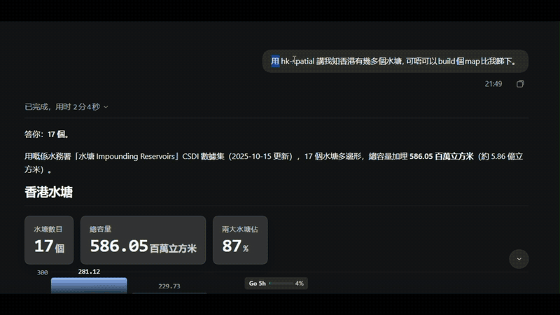
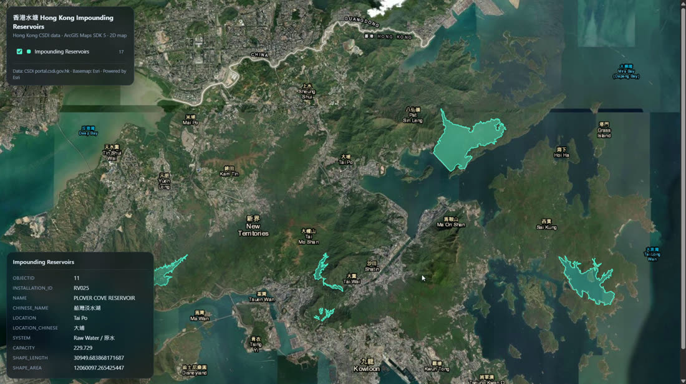

# hk-spatial-mcp

### Hong Kong's **1,154 official spatial datasets** → any AI agent, in one function call.

Point any MCP-capable client at this server and it can search the whole Common Spatial Data
Infrastructure catalogue in English, 繁體中文 or 简体中文, pull real GeoJSON, answer questions with
numbers and charts, and hand back a 2D map, a 3D scene or a printable static map. **No ArcGIS account,
no API key, no GIS library, no `npm install`** — one Python process and the open data itself.

> **Built by [Cyrus Chu](https://cyruschu.com)** — GIS × AI, Hong Kong.
> [cyruschu.com](https://cyruschu.com) · [LinkedIn](https://www.linkedin.com/in/cyrus-chu-287b91337)

[](LICENSE)
[](pyproject.toml)
[](https://modelcontextprotocol.io)
[](#data-source-and-coverage)
[](#requirements)
[](https://github.com/Cyruschu430/hk-spatial-mcp/actions/workflows/selftest.yml)

| | |
|---|---|
| **Ask in Cantonese, get an answer** | `用 hk-spatial 講我知香港有幾多個水塘, 可唔可以 build 個 map 比我睇下` → 17 reservoirs, 586.05 million m³, chart, then the map below. Takes ~2 minutes end to end, most of it the model thinking. |
| **Any of the 1,154 datasets** | EV chargers by district · registered man-made slopes · private buildings · public toilets · 3D pedestrian network · hospitals · country-park attractions · waste facilities · school social work · district boundaries. The reservoirs below are **one example**, not the scope. |

## See it work

**A conversation, not a config file** — the real client run behind the answer above:



**The map it returned** — [▶ **open it live**](https://cyruschu430.github.io/hk-spatial-mcp/)
([3D scene](https://cyruschu430.github.io/hk-spatial-mcp/scene.html)): pan, zoom, and **click any feature to see
every attribute field**. No install needed to look; these pages are the unmodified output of `build_map` /
`build_scene`, served as static files.

[](https://cyruschu430.github.io/hk-spatial-mcp/)

*(Attribute card from `OBJECTID` to `SHAPE_AREA` is built by the server's own click handler — not a third-party
popup library. Basemap tiles are keyless Esri; data is CSDI open data.)*

The demo is not a mock-up and not a separate app: `docs/` is the plain output of these calls. Regenerate it
with any other dataset IDs you like:

```bash
HK_MCP_DIR=./docs python3 -c "
import hk_spatial_mcp as m
res, att = 'wsd_rcd_1629267205232_96199', 'afcd_rcd_1728896853370_57183'
m.load_hk_data(res); m.load_hk_data(att)
m.build_map([res, att], 'Hong Kong — Impounding Reservoirs & Country Park Attractions', 'imagery')
m.build_scene([res], 'Hong Kong Impounding Reservoirs', 'imagery', tilt=65)"
```

> **Unofficial, community project.** CSDI is operated by the Spatial Data Office, Development Bureau,
> HKSAR Government. The Office has stated that it plans to develop its own CSDI MCP server in 2027.
> This repository is an independent implementation and claims no affiliation with the Government, the
> Spatial Data Office, or Esri.

**Contents**

- [See it work](#see-it-work)
- [Capabilities](#capabilities)
- [Requirements](#requirements)
- [Installation](#installation)
- [Prompt cookbook](#prompt-cookbook)
- [Tool reference](#tool-reference)
- [Interactive Building Scene Layers](#interactive-building-scene-layers)
- [Floor filtering when the model is not a Building Scene Layer](#floor-filtering-when-the-model-is-not-a-building-scene-layer)
- [Configuration](#configuration)
- [Data source and coverage](#data-source-and-coverage)
- [Using it without the SDK](#using-it-without-the-sdk-or-inside-your-own-information-system)
- [Keyless Esri services](#keyless-esri-services)
- [Performance](#performance)
- [SDK and design system](#sdk-and-design-system)
- [Design notes](#design-notes)
- [FAQ](#faq)
- [Troubleshooting](#troubleshooting)
- [Verification](#verification)
- [Licensing and attribution](#licensing-and-attribution)

---

## Capabilities

| Capability | Detail |
|---|---|
| **Catalogue search** | All 1,154 CSDI datasets, indexed locally and relevance-ranked. English, 繁體中文 and 简体中文 queries supported. |
| **Data retrieval** | Any dataset as GeoJSON in EPSG:4326, returned as a summary (feature count, geometry types, attribute fields, bounding box) rather than a raw feature dump. |
| **Map rendering** | One or many datasets rendered as an interactive **2D map** or **3D scene** (ArcGIS Maps SDK for JavaScript, keyless public basemap; 3D adds Terrain3D relief), served on `localhost`. |
| **Feature inspection** | Click any feature to open an attribute card — every field from the dataset, bilingual column names where CSDI provides them, URLs rendered as links. |
| **Spatial join** | `spatial_join` counts points inside polygons from two loaded datasets — "which district has the most of these" — with a pure-Python point-in-polygon test, no geometry service. |
| **Answers, not just maps** | `summarise_hk_data` answers a question in text — counts, sums or averages grouped by any field — and renders a bar chart page. `query_hk_data` returns a few individual rows so a single value can be checked. |
| **Printable static map** | `export_static_svg` writes a vector map **with the data drawn** — basemap tiles plus the features as real shapes — ready to print to PDF from a browser. |
| **BIM, driven not just read** | `bim_audit` reads an i3s Building Scene Layer over REST (no `/query`, no `arcgis` package); `bim_viewer` opens a live model with a floor filter, category and discipline toggles, and `bim_filter` / `bim_select` act on that open page — the camera flies to a component named by `uid`, and the number of elements shown is counted, not guessed. |
| **Earth observation** | `eo_search` finds Sentinel-2 / Landsat / DEM scenes from the Microsoft Planetary Computer STAC catalogue — keyless. `eo_stats` returns monthly NDVI / NDBI / NDMI over a bbox as **statistics**, never a raster, so it is safe on a small machine. |
| **Geocoding and geometry** | Address ↔ coordinate (both directions), project / buffer / simplify on any GeoJSON geometry, ground elevation, via Esri's public services. No key required. |
| **Basemaps** | 11 keyless Esri basemap styles (imagery, topographic, streets, light/dark gray, terrain, hillshade, ocean, physical, natgeo, shaded relief) plus an optional labels overlay. |
| **Static map export** | Render a basemap PNG (no key) into the workspace for reports and decks. |
| **ArcGIS Online (optional)** | Publish a dataset as a hosted feature layer, or call any ArcGIS REST endpoint (item search, feature queries, geoprocessing jobs) with your own token. |

The data layer is the primary value: CSDI is the source of truth. The map renderer is interchangeable,
and the ArcGIS Online tools are optional extensions that require your own credentials.

---

## Requirements

- Python 3.10 or newer, or [`uv`](https://docs.astral.sh/uv/) (recommended — `uvx` runs the server without a manual install)
- **No other dependencies.** Every tool function is pure standard library (`json`, `math`, `urllib`,
  `http.server`, `threading`, `pathlib`) — verified by running them under `python3 -S`, which disables
  site-packages entirely. `mcp` is imported inside `main()` only, so it is needed to *serve* MCP, never to
  use the functions from your own code.
- An MCP-capable client (Claude Desktop, Cursor, WorkBuddy / CodeBuddy, Codex, Hermes, **DeepSeek Harness
  (DSH)**, or any stdio MCP client)
- Network access to `portal.csdi.gov.hk`
- *Optional:* an ArcGIS Online user or OAuth token, needed only for the publishing and content tools

---

## Installation

Add the server to your MCP client configuration:

```json
{
  "mcpServers": {
    "hk-spatial": {
      "command": "uvx",
      "args": ["--from", "git+https://github.com/Cyruschu430/hk-spatial-mcp", "hk-spatial-mcp"],
      "env": {
        "ARCGIS_TOKEN": "",
        "HK_MCP_PORT": "8777"
      }
    }
  }
}
```

Configuration file locations vary by client:

| Client | Configuration file |
|---|---|
| Claude Desktop (macOS) | `~/Library/Application Support/Claude/claude_desktop_config.json` |
| Cursor | `<project>/.cursor/mcp.json` |
| WorkBuddy / CodeBuddy | `~/.workbuddy/mcp.json` or `<project>/.workbuddy/mcp.json` |
| Codex | `~/.codex/config.toml` |
| DeepSeek Harness (DSH) | its own MCP server settings, added as an stdio entry named `hk-spatial` — set a generous `toolCallTimeoutMs` (180000) so large layers are not cut off |

Any client that speaks MCP over stdio will work; the JSON shape above is the common form. Once the
client reports the server as connected, the tools are available in the conversation.

**DeepSeek Harness note.** DSH keeps its own cache of the `uvx` environment, so after a new release run
`uv cache prune` (or `uvx --refresh …`) before expecting the new tools — otherwise you keep testing the
previous version. Its MCP client connects over stdio exactly as in the JSON above; a full
search → summarise → map → click-a-feature flow completes in about two minutes end to end, most of it the
model thinking rather than the tools.

**Windows note.** `uvx --from git+…` needs `git` on `PATH`. Set `HK_MCP_DIR` to an absolute path
(for example `C:\\Users\\you\\hk-spatial`) — the default `./hk-spatial` is relative to whatever working
directory the client happens to launch with. Maps are served on `http://localhost:<HK_MCP_PORT>/`, so
open that URL in your own browser.

**Manual installation (without `uvx`)**

```bash
git clone https://github.com/Cyruschu430/hk-spatial-mcp
cd hk-spatial-mcp
pip install "mcp>=1.2"
python3 hk_spatial_mcp.py          # stdio MCP server
```

---

## Agent skill — ship the instructions with the tools

`SKILL.md` (repo root, frontmatter `name: hk-spatial`) is the agent-facing half of this server. The tools
say what they do; the skill says what the agent must **not** do — write its own fetch code, paste feature
records into the chat, invent a GFA, or claim compliance. Load it wherever your client keeps skills:

| Client | Where it goes |
|---|---|
| Claude Code / Claude Desktop | `~/.claude/skills/hk-spatial/SKILL.md` |
| DeepSeek Harness | add this repo as a skill-hub market source, or drop it in `~/.dsh/skills/hk-spatial/` |
| WorkBuddy / CodeBuddy | `~/.workbuddy/skills/hk-spatial/SKILL.md` (or paste it as the system prompt) |
| Anything else | paste `SKILL.md` into the system prompt — it is plain Markdown, no tooling required |

It is versioned with the server on purpose: the skill documents behaviour that changes when the reader
changes (the i3s 1.4–1.6 fallback, the nested-discipline merge, `completeness_pct` being *% empty*). Re-pull
it after an upgrade, or the agent will quote yesterday's rules against today's tools.

---

## Prompt cookbook

Ready-to-use instructions for an AI client. The English and Chinese versions are equivalent — use
whichever suits your users; the underlying tool calls are identical.

### 1. Connectivity check

```
Search the CSDI catalogue for "country park" using hk-spatial and list the first five datasets.
```
```
用 hk-spatial 搜尋 CSDI 目錄中的「郊野公園」，列出前五個數據集。
```

### 2. Data to map (the core workflow)

```
Using hk-spatial, find the Hong Kong country parks dataset, load it, and build an interactive web map
titled "HK Country Parks". Then report the preview URL.
```
```
用 hk-spatial 找出香港郊野公園數據集，載入後建立一個標題為「HK Country Parks」的互動地圖，
並回報預覽網址。
```

### 3. Chinese-language query, single layer

```
Using hk-spatial, find the location data for public toilets in Hong Kong and produce a map.
```
```
用 hk-spatial 找出全港公廁的位置數據，並產生地圖。
```

### 4. Multiple layers in one map

```
Using hk-spatial, retrieve three datasets — electric vehicle chargers, public hospitals and the
pedestrian network — and place them all on a single map with a distinct colour per layer and the
dataset name shown in the legend.
```
```
用 hk-spatial 同時取得三組數據：電動車充電站、公立醫院及行人路網絡，全部放在同一張地圖上，
每層使用不同顏色，並在地圖圖例中標示數據集名稱。
```

### 5. Extending an existing map

```
Using hk-spatial, add the bus routes dataset to the map you just built and confirm when it is added.
```
```
用 hk-spatial 在剛才建立的地圖上再加入「巴士路線」數據集，完成後通知我。
```

### 6. Catalogue reconnaissance before committing

```
Using hk-spatial, list every dataset related to slope safety and describe each one in a single sentence.
```
```
用 hk-spatial 列出所有與斜坡安全相關的數據集，並為每個數據集提供一句說明。
```

### 7. Geocode an address onto the map

```
Using hk-spatial, geocode "Hong Kong Convention and Exhibition Centre" and add it to a map as a
single labelled point.
```
```
用 hk-spatial 將「香港會議展覽中心」地理編碼，並以單一標註點加入地圖。
```

### 8. Coverage ring (buffer) around a facility

```
Using hk-spatial, load the electric vehicle chargers dataset, then produce a 500-metre buffer around
the first charger with geometry_op and add it to the map so the coverage ring is visible.
```
```
用 hk-spatial 載入電動車充電站數據，再用 geometry_op 為第一個充電站建立 500 米緩衝區，
並加入地圖以顯示其覆蓋範圍。
```

### 9. Ask a question, get a table and a chart

```
Using hk-spatial, find the EV charger dataset and tell me how many public chargers there are in each
district, with a bar chart.
```
```
用 hk-spatial 搵電動車充電站數據，話我知每區有幾多個公眾充電站，並出一張棒形圖。
```

### 10. Check one value, then print a static map

```
Using hk-spatial, query the reservoir dataset for the row whose name matches 大潭, then export a printable
static map of the reservoirs that I can open and print to PDF.
```
```
用 hk-spatial 喺水塘數據查「大潭」嗰一筆記錄，然後輸出一張可直接列印做 PDF 嘅靜態地圖。
```

### 11. Same data as a 3D scene

```
Using hk-spatial, take the country parks and slopes datasets and render them as a 3D scene with terrain
relief, camera tilted about 60 degrees, then give me the scene URL.
```
```
用 hk-spatial 將郊野公園及斜坡數據渲染成 3D 場景，開啟地形起伏、鏡頭傾斜約 60 度，
並提供場景網址。
```

### 12. Publish to ArcGIS Online *(requires `ARCGIS_TOKEN`)*

```
Using hk-spatial, publish the country parks dataset to my ArcGIS Online organisation as a hosted
feature layer titled "HK Country Parks" and return the item link.
```
```
用 hk-spatial 將郊野公園數據集發佈到我的 ArcGIS Online 組織，命名為「HK Country Parks」，
並回報項目連結。
```

### 13. Query existing ArcGIS Online content *(requires `ARCGIS_TOKEN`)*

```
Using hk-spatial's arcgis_request tool, list the five most recent feature layers in my ArcGIS Online
account together with their names and item IDs.
```
```
用 hk-spatial 的 arcgis_request 工具，列出我 ArcGIS Online 帳戶中最近五個圖層服務的名稱與項目 ID。
```

### 14. Audit a BIM model and show the finding on the model

```
Using hk-spatial, audit the ZCB building scene layer, then open the interactive viewer and filter it
to level 5 — tell me how many elements that leaves. Then select the door with uid "Doors/0:33" and
fly the camera to it.
```
```
用 hk-spatial 審核 ZCB 建築場景圖層，開啟互動檢視器並篩選到 5 樓，告訴我還剩幾多個構件；
然後選取 uid 為「Doors/0:33」的門，將鏡頭飛到該處。
```

The reply should contain a count that matches the filter (`272 of 14,416` for level 5 on ZCB) and a
`viewer` url. The page is already open by then — filtering and selecting update it in place, with no
reload and no second url.

### 15. Enforce the intended workflow

Load `SKILL.md` as the agent's skill or system prompt. It constrains the agent to the
search → load → build_map sequence, prohibits fabricating data, prohibits pasting feature records into
the conversation, and requires the "Powered by Esri" attribution to be preserved.

If the agent starts writing its own HTTP code, instruct it explicitly:

```
Do not write custom fetch code. Use the hk-spatial tools — they already handle CSDI's catalogue
search, GeoJSON export, coordinate system and non-spatial datasets.
```
```
請勿自行編寫抓取程式碼，改用 hk-spatial 工具；它已處理 CSDI 的目錄搜尋、GeoJSON 匯出、
坐標系統及非空間數據集等細節。
```

---

## Tool reference

### `search_hk_data(keyword: str = "", limit: int = 10, offset: int = 0)`

Searches all 1,154 CSDI datasets using the local index. Returns `dataset_id`, English and Chinese
titles, publishing organisation, last update date, relevance score and an `exportable` flag.

- Omitting `keyword` enumerates the catalogue; paginate with `offset`. `limit` is capped at 30.
- English and Chinese queries are both supported; Hong Kong terminology is expanded automatically
  (廁所 → 洗手間, 行人路 → pedestrian, 電動車 → electric vehicle charging, 斜坡安全 → slope).
- When nothing matches locally, the tool falls back to the CSDI catalogue service for broader recall.

### `load_hk_data(dataset_id: str, name: str = "")`

Downloads a dataset as GeoJSON (EPSG:4326) into the workspace and returns a summary: feature count,
geometry types, attribute field names, bounding box and file path. Feature records are never returned
to the model.

**A dataset can be attribute-only.** Some CSDI exports are a valid FeatureCollection whose every
feature is `geometry: null`. Two were verified live on 2026-11-05 — LandSD **Building**
(`landsd_rcd_1637211194312_35158`, 87,982 features, **0** with geometry) and LandSD **Lot**
(`landsd_rcd_1637217253134_22729`, 1,606 / **0**). Reading them used to look like success: a healthy
feature count, `bbox: null`, and then a map that drew nothing. They are now refused with the reason
named, and `build_map` drops them from a multi-layer request instead of adding an empty layer.

The attributes are real, so `query_hk_data` and `summarise_hk_data` still work on them — only the
geometry is missing. For mappable lot polygons, use the ArcGIS mirror
`Lot_in_Hong_Kong/FeatureServer/0` on `services3.arcgis.com` through `arcgis_request`.

### `summarise_hk_data(dataset_id, group_by="", value_field="", agg="count", top=20)`

Answers a question about a dataset in **text**, without putting features into the chat.

- No `group_by` → an overview: feature count, geometry types, the fields worth grouping by (with their
  cardinality) and the numeric fields.
- `group_by="NAME_OF_DISTRICT_COUNCIL_DISTRICT_EN"` → features per group.
- `agg="sum"` (or `"avg"`) plus `value_field="MEDIUM_IEC62196_no"` → totals or averages per group.

Returns an aligned text table, the same rows as data, and a `chart_url` for a rendered bar chart page.
Example — EV charging sockets per district in Hong Kong:

```text
group                  sum of MEDIUM_IEC62196_no
---------------------------------------------
Kwun Tong                            1,438
Kowloon City                         1,229
Sha Tin                                874
...
```

### `spatial_join(points_dataset, polygons_dataset, field="", top=20)`

Counts the points of one loaded dataset inside each polygon of another — the join `summarise_hk_data`
cannot do, answered locally with a ray-casting test in pure Python (no geometry service, no credential,
no data leaving the machine).

Both datasets must already be loaded with `load_hk_data()`. Call once with `field=""` to get the
polygon's candidate label fields, then again with one of them:

```text
spatial_join("cedd_rcd_1640249280153_17521", "censtatd_rcd_1635932856094_19982", "dc_eng")

group                            points
---------------------------------------
Islands                           1,475
Sai Kung                          1,157
Sha Tin                           1,123
...
```

10,854 landslide points against 18 district polygons: 10,850 matched, 4 fell outside every district,
**1.2 s** on a 2 vCPU VPS. A y-bucketed segment index keeps that down — a naive scan of the same pair
takes 54 s. Returns per-polygon counts, the aligned table, a `chart_url`, `matched` / `unmatched` and
the features it had to skip (non-point inputs).

### `query_hk_data(dataset_id, where="", fields="", limit=5)`

Returns a few individual features so one value can be verified without opening the GeoJSON file. `where`
is either `FIELD=value` (case-insensitive match on that field) or bare text searched across all fields.
Rows are hard-capped at 20 and each row carries its `_geometry` type and first vertex — this tool exists to
check a number, not to dump a dataset.

### `dataset_status(dataset_id="", probe=False, limit=10, stale_after_days=365)`

Answers "is this dataset still there, and how old is it?" — the question every downstream user
asks only after something breaks.

- **No `dataset_id`** → the `limit` oldest datasets in the catalogue, so drift is visible at a glance.
- **`probe=True`** → also calls the CSDI export endpoint and reports HTTP status + latency. Reads
  **2 KB and hangs up**, so it never re-downloads a dataset just to say "yes". Capped at 10 probes
  per call.
- Reports catalogue `dct:modified` age, a `fresh` / `aging` / `stale` verdict, the `exportable` flag,
  and the local cache size/age if you have already downloaded it.

> **Catalogue date ≠ data freshness.** `catalogue_updated` is when CSDI revised the *record*.
> The statistical reference period of the data itself is a separate thing and is not reported here.
> Keep both when you cite.

```json
{"checked": 5, "probed": 1, "stale": 5,
 "datasets": [{"dataset_id": "landsd_rcd_1631586233...", "catalogue_updated": "2022-03-31",
               "age_days": 1667.0, "state": "stale", "exportable": true, "local_cache": null,
               "live": {"http": 200, "ms": 228, "body": "geojson"}}]}
```

### `build_map(dataset_ids, title="Hong Kong Spatial Data", basemap="imagery", labels=False)`

Builds an interactive map from the loaded datasets and serves it on `http://localhost:<HK_MCP_PORT>/`.
Returns the URL, layer list, total feature count and warnings for oversized layers. Layers above 3,000
features are streamed from the served file rather than inlined into the page.

`basemap` accepts any keyless style: `imagery`, `topographic`, `streets`, `light-gray`, `dark-gray`,
`terrain`, `hillshade`, `ocean`, `physical`, `natgeo`, `shaded-relief`. `labels=True` adds Esri's
boundaries-and-places reference overlay on top.

**Clicking a feature** opens an attribute card in the bottom-left corner of the page: every attribute field
of that feature, `NAME_TC` / `LOCATION_TC` shown next to the English columns, and any URL rendered as a
link. The field labels come from the dataset itself, so nothing is hard-coded per dataset. Multi-layer maps
work the same way — whichever layer the click hits wins.

### `build_scene(dataset_ids, title="Hong Kong Spatial Data", basemap="imagery", labels=False, tilt=60)`

Same datasets as `build_map`, rendered in a **3D scene** served at `scene.html`: Terrain3D ground,
tilted camera (`tilt` degrees), lines and polygons draped on the terrain. Use it when relief, height or
coastal context matters — slopes, trails, towers, district skyline. Keyless, same warnings as `build_map`.

Both pages are plain static HTML over the same served GeoJSON, so you can keep the 2D map for analysis and
the 3D scene for the walkthrough of the same workspace.

Every build also writes a **build-specific page** (`2d-<title>-<hash>.html`, `3d-…`, `chart-…`) and returns
its URL, so building a new map never destroys an earlier one. The conventional names (`index.html`,
`scene.html`, `chart.html`) are refreshed to the newest build for convenience; `latest_url` in the response
points at them.

### `geocode_address(single_line="", max_results=5, lon=None, lat=None)`

Geocodes an address or place name and returns candidates with longitude, latitude and a match score
(EPSG:4326). Pass `lon` and `lat` instead to **reverse geocode** a coordinate into a street address — in
Hong Kong it returns Chinese addresses. No key required; the endpoint is rate-limited, so use an ArcGIS
Location Platform key for production volumes.

### `elevation_at(lon: float, lat: float)`

Ground elevation in metres from Esri's public Terrain3D service. No key required.

### `export_static_map(bbox=None, center=None, zoom=14, basemap="streets", size="900,600")`

Renders a basemap PNG into `<workspace>/exports/` and returns the file path and a served URL. Give either
`bbox` (`minx,miny,maxx,maxy` in EPSG:4326) or `center` + `zoom`. No key required.

The image contains the **basemap only** — CSDI features are not drawn on it. For a static map that *does*
include the data, use `export_static_svg` below.

### `export_static_svg(dataset_ids, title="Hong Kong", basemap="streets", max_px=1400)`

Writes a printable static map **with the data drawn**: basemap tiles referenced by URL plus every feature as
a real vector shape (points, polylines, polygons), a legend box with per-layer colours and counts, and the
attribution line. Output is one self-contained `.svg`; open it in a browser and print to PDF for a report.

The zoom is chosen automatically so the whole extent fits within `max_px`. No key, no headless browser and no
image library are involved — it is string assembly over the same local GeoJSON the other tools use.

### `geometry_op(operation, geojson, in_sr=4326, out_sr=None, distance=500, unit="meters", max_deviation=None)`

Runs one geometry operation through Esri's public Geometry service and returns GeoJSON. No key required.

| Operation | Use |
|---|---|
| `project` | Reproject a geometry, e.g. `in_sr=2326, out_sr=4326` for CSDI layers published in HK1980 Grid |
| `buffer` | Coverage rings — `distance` in `unit` (`meters`, `kilometers`, `feet`, `miles`, `nauticalmiles`) |
| `simplify` | Reduce vertex count on large polygons before rendering (`max_deviation` in input units) |

Accepts and returns GeoJSON `Point`, `MultiPoint`, `LineString`, `MultiLineString`, `Polygon` and
`MultiPolygon`.

### `arcgis_request(path: str, params: dict | None = None, method: str = "GET")`

Calls any ArcGIS REST endpoint with the configured token. The token is never echoed back in a response.

```python
arcgis_request("search", {"q": "owner:me", "num": 10})                      # find items
arcgis_request("content/items/<itemId>/data")                               # item JSON
arcgis_request("<featureServiceUrl>/0/query", {"where": "1=1", "returnCountOnly": "true"})
```

### `publish_layer(dataset_id: str, title: str = "", tags: str = "CSDI,Hong Kong")`

Uploads a dataset to ArcGIS Online as a hosted feature layer and returns the `itemId` and item URL.
The async publish job is polled to completion; the reply carries the new `service_url`.
Consumes organisation credits and storage capacity.

### `publish_scene(source: str, title: str = "")`  *(requires `ARCGIS_TOKEN`)*

Publishes a Scene Package (`.slpk` item id) as a hosted scene layer in **your** content: the package
bytes are downloaded once into the local cache, re-uploaded, and published. The resulting
`service_url` answers every BIM tool — pass it to `bim_findings(mode="scene")` and the 3D viewer
finally draws the model itself for package sources. 3D Object and Building Scene Layer packages
both publish. The scene service is created **private**; this tool never shares anything, so a
copied package stays visible to your account only until you share or delete it yourself.
`bim_findings(mode="scene")` on that private service embeds a session token in the local
viewer page (IdentityManager, `www.arcgis.com` server key) so the model draws without
sharing — localhost use only, the token expires with your session. See
[`docs/scene-publishing-notes.md`](docs/scene-publishing-notes.md) for every AGOL quirk
found on the way (outputType, job-status polling, name rules, 409 duplicate delivery,
private-viewer auth) and the enhancement roadmap.

**Authentication.** `arcgis_request`, `publish_layer`, `publish_findings` and `publish_scene`
require `ARCGIS_TOKEN` set to a user or OAuth token. An ArcGIS API key is sufficient for basemaps
and geocoding but cannot read or create organisation content.

### `webscene_viewer(item_id: str)`

Draws an ArcGIS **Web Scene** in a local 3D viewer and returns the localhost url. Every
operational layer the viewer understands — 3D object scene services and integrated meshes —
becomes a toggleable layer in the panel, and the scene's own initial camera is reused, so the
building is framed on load. Point clouds, Gaussian splats and the scene's basemap are skipped
(the satellite basemap stands in). Private scene documents need `ARCGIS_TOKEN`; layers that are
world-readable need no token at all, which makes this a quick way to look at a shared BIM
web scene without ArcGIS Pro or a sign-in.

---

## Interactive Building Scene Layers

A BIM question usually ends with "…and show me". These four tools let the agent **act on** an open
model instead of only describing it. They share one `viewer` handle, and the page polls its state
file every 1.2 s — so a later call redraws the tab the user is already looking at. No reload, no
second url, no websocket.

### `bim_viewer(source, title="", overlay="", refresh=False)`

Opens the interactive 3D viewer and returns the handle you pass to the other three.

- `viewer` — 10-character handle (`9d143640d1`); `url` — what to open. **Call this first.**
- `levels`, `categories`, `disciplines` come back **with element counts**, so the agent picks a
  filter value that exists instead of inventing one. On ZCB that is 21 levels / 18 categories /
  4 disciplines over 14,416 elements. The i3s sentinel level `-2147483648` (meaning "unset") is
  filtered out of that list rather than offered as a floor.
- `overlay` takes comma-separated CSDI dataset ids drawn under the model — lots, registered
  slopes, zoning — so a height or setback claim has site context behind it.
- Every BIM tool accepts the handle, not just the interactive ones: `bim_elements(handle, ...)`
  resolves it back to the service, so an agent can hold one short string for a whole session.

### `bim_filter(source="", floors="", categories="", disciplines="", clear=False)`

Narrows what draws and reports **how many elements that leaves** (`elements_shown` /
`elements_total`) — counted from the cached attribute rows, not estimated from a screenshot.

- `floors="5"` / `"3,4,5"` / `"G,1,2"` — `BldgLevel` values, i.e. the storey number, **not** an
  elevation in metres. `bim_filter(viewer, floors="5")` on ZCB → `BldgLevel IN (5)` → 272 of 14,416.
- `categories="Walls,Doors"` — sublayer names as `bim_viewer()` lists them; everything else is
  turned off. `floors="5", categories="Walls,Doors"` together → 52 shown, 16 categories hidden.
- `disciplines="Structural"` → `Discipline IN ('Structural')` → 3,745 on ZCB.
- An unknown category is a **refusal**, not a silent no-op: the error lists the valid names. Same
  for `clear=True`, which resets the model rather than filtering it to nothing.

The mechanism matters if you extend this. Measured in a browser, not assumed:

| what you reach for | result |
|---|---|
| `BuildingFilter` expression (`BldgLevel` / `Discipline` / `Category`) | **works** — isolates a storey or a discipline |
| second `BuildingFilterBlock` `1=1` as `wire-frame` | **works** — ghosts the context, target stays solid |
| `sublayer.visible` | **works** — the reliable category switch |
| `sublayer.definitionExpression` | **no effect** — 0.0% pixel change |
| `sublayer.queryFeatures` / `queryExtent` | **throws** `query-not-available` on the sublayer too |
| `BuildingFilter` on `OBJECTID` | **matches ~17 elements, not 1** |
| `1=1` as `x-ray` (context pass) | **draws nothing** — the solid block goes too; use `wire-frame` |
| `import .../support/BuildingFilterBlock.js` | **404 on the 4.31 CDN** — there is no such module |

`BuildingFilterBlock` is constructible only through the collection: pass **plain object literals** in
`filterBlocks` and the SDK coerces them (each comes back with
`declaredClass === "esri.layers.support.BuildingFilterBlock"`). Importing the class by path fails, and
because it fails inside a `Promise.all` of module imports it takes the whole viewer down with it —
the symptom is a module-load rejection, not a filter problem.

The last two rows contradict the published guidance, which says to query the *sublayer* rather than the
root and to isolate one component with `OBJECTID = n`. On a hosted BSL neither holds: both query methods
throw on the sublayer, so the browser cannot read geometry at all, and `OBJECTID_1` restarts in every
sublayer — on ZCB, `OBJECTID_1 = 33` matches 17 elements (a beam, a column, a door, a pipe) and renders as
a building-shaped scatter rather than one component.

### `bim_select(source="", ids="", uids="", where="", isolate=True, ghost=True, tilt=62, heading=20)`

Flies the camera to chosen elements, marks them, and shows the first one's attributes.

- `uids="Doors/0:33"` — **the exact way to name an element.** A `uid` is `sublayer/node:id`, and
  that triple is the only unique key in i3s: feature ids restart inside a node *and* node ids
  restart in every sublayer, so on ZCB `ids=[33]` matches **17** different elements across 17
  sublayers. `bim_elements()` rows carry the `uid`; quote that.
- `ids=33` (or `[33]`, or `"33,34"`) is still accepted for convenience, but the reply reports how
  many it matched, so a wrong guess is visible. `where="Category=door AND BldgLevel=10"` is the
  third way in — on ZCB that is 13 elements.
- `isolate=True` narrows the drawing to the hits' own categories and levels, so the selection is not a
  red dot lost in a whole building. `bim_clear` undoes it.
- `ghost=True` (the default for a focused selection, ≤200 elements) keeps the rest of the building as a
  **wire-frame outline** instead of hiding it, and frames the whole building rather than the element. That
  is what makes one component readable in context — i3s still cannot hide every other instance, so
  ghosting is the honest alternative. Set `ghost=False` to fly right up to the element instead.
- `unknown_uids` / `unknown_ids` report a typo instead of a silent zero. Asking to select nothing
  is refused as an error rather than returning an empty success.
- Returns `bbox` (the elements), `camera_bbox` (where the camera aimed) and `record` — the same attribute
  card the page shows, so the agent can *name* what it flew to:
  `{"uid": "Doors/0:33", "Category": "door", "Family": "1000 x 2032mm", "BldgLevel": 10,
  "Mark": "D7yy"}`. With several matches, `record_note` says which one the card describes.

Ghosting has two traps, both of which make it look broken:

- Filter by the **`Category` attribute**, not the sublayer title. The attribute holds lowercase Revit
  values (`'door'`) while the sublayer is called `Doors`; a bare `'Doors'` is not a predicate, it silently
  matched everything, the solid block covered the whole building and nothing looked ghosted.
- Do **not** also set `sublayer.visible`. Shell sublayers (`ExteriorShell`, `Site`, `Stairs`) are absent
  from the element catalogue, so hiding "every category except Doors" leaves the envelope drawn solid over
  the ghost.

Mode values are hyphenated: `{ type: "wire-frame" }`, `{ type: "x-ray" }`, `{ type: "solid" }`. Bare
`wireframe` / `xray` are accepted at construction and then throw inside the SDK
(`Cannot read properties of null (reading 'type')`).

All three names parse, but they are not interchangeable in practice: **`x-ray` is not a usable ghost
pass on a hosted i3s layer.** Asked for the whole building as `1=1` in `x-ray`, the layer stops drawing
*everything* — the solid target block included — so the tower goes blank instead of becoming
translucent. `wire-frame` never does this and is the only context mode worth reaching for. If a filtered
scene goes empty while the unfiltered one renders, the filter block is the suspect, not the service.

### `bim_clear(source="")`

Whole model, no selection, no filter. `state_rev` advances, so the open page visibly resets.

**What the camera actually does.** `goTo({center, scale})` resolves without error in this page and
moves nothing, so the viewer assigns a `Camera` directly. The view's centre is where the optical
axis meets the ground, so with the eye at height `z` and tilt `t` the camera must sit `z·tan(t)`
*behind* the target along the heading — placing it there centres the target in one step
(measured error: 2 px horizontal, 27 px vertical) instead of iterating a feedback loop that never
converged.

The inverse is where this goes wrong, and it fails silently. `tilt` is measured **from vertical**
(0 = straight down, 90 = horizon), so when you have a horizontal distance `d` and want the eye
height, it is `d·tan(90 − t)` — **not** `d·tan(t)`. Using `tan(t)` raises the eye roughly twice as
far as intended and the building leaves the frame entirely, which looks exactly like "the layer
failed to load". If a hand-placed camera shows an empty scene while the panel reports elements and
nodes, check this term before you debug the service. `d·tan(90 − t)` at `d = 480 m`, `t = 62°` puts
the eye at 255 m over the target and frames a 168 m tower whole.

The vertical aim is the element's own storey elevation (`BldgLevel_Elev`), not a fixed height.
Storey numbers are not heights: on ZCB, `BldgLevel = 10` sits at 3.95 m. Aiming a door at a
hard-coded 12 m left it ~77 px low in an 800 px view, framed mostly on car park.

**Two facts that look like bugs but are not.** `position` in an i3s node is the **node anchor**, not
the element — one node's 241 features share it. It still locates the building correctly (the drawn
model's ground pad lands exactly at that centre), so frame by it; just do not read it as a
per-element coordinate. And the service's declared `fullExtent` is not a reliable target either: on
ZCB that document sat ~200 m from the geometry. Aim at the element-position extent.

**Expect a slow first paint.** A hosted BSL streams tiles: ~40 s for a 14 k-element model on
software rendering. If the page looks empty, wait — do not conclude the layer failed, and do not
`hitTest` to decide (it returns empty for BSL geometry even when the model is on screen).

---

## Floor filtering when the model is not a Building Scene Layer

A BIM delivered as a **web scene** is often not one `BuildingSceneLayer` at all: the item holds a
`GroupLayer` of sibling `ArcGISSceneServiceLayer`s, one per published service. Building E
(`2b495455eb4148bbb05f1b255c0a527b`) is 21 of them. There is then no sublayer tree, no
`BuildingFilter`, and **no floor filtering that the SDK can do for you** — `BldgLevel` is just an
attribute, and whether it can isolate a storey depends entirely on how the exporter grouped geometry
into i3s **nodes**.

An i3s node is the unit the renderer draws and hides. A predicate does not select elements inside a
node; it selects the node. So if nodes span storeys, a storey filter cannot work:

| measured on Building E | value |
|---|---|
| elements in `Wall_Mullions` | 3,910 (**98.3%** of the whole model) |
| nodes holding them | **34** |
| nodes whose elements all share one level | **0 of 34** |
| node composition | 14 hold levels 0+1+3+4, 19 hold 1+3+4 |
| element bbox height, median | 20.55 m |

That is why "select L0" drew the entire glass façade. Revit→i3s exports commonly group nodes by
element *type* rather than by storey, so `BldgLevel` filtering is only as good as the publisher's
grouping — and it is not something the client can fix by asking differently.

**Check it in one call before promising a floor filter.** Compare node count to element count, then
test whether any node holds a single level:

```python
# from the cached rows: a level filter can only work if some node is level-pure
pure = sum(1 for n in nodes if len({e["BldgLevel"] for e in n["elements"]}) == 1)
```

If `pure == 0`, say so and filter geometrically instead. On Building E the honest answer was
"no storey can be filtered by attribute", reported as a finding — not worked around silently.

**The alternative that does work is to cut the geometry.** `SliceAnalysis` removes everything above a
horizontal plane regardless of node grouping, so it isolates a storey because the geometry is gone,
not because a predicate matched. Verified numerically by z-sampling `view.hitTest()` either side of
the cut:

| plane z | hits span | storey isolated |
|---|---|---|
| 408.20 | 391.73 – 408.20 | above L4 |
| 403.61 | 391.73 – 403.60 | above L3 |
| 399.20 | 391.73 – 399.18 | above L1 |
| 394.65 | 391.73 – 394.60 | above L0 |

Slab elevations came from clustering `hitTest` z values on a near-orthographic elevation view, not
from a level field: **391.73 / 394.66 / 399.20 / 403.61 / 408.19**, roof cap 408.64. (The model's
`fullExtent` is 339.3–460.9 and is not the building — see the note above.) Set the cut slightly
*below* the slab top (`CUT_EPS = 0.5`), or the cut plane is capped by the slab's own solid sheet and
the section reads as a blank white plate.

SDK 5.0 specifics, each of which cost a debugging cycle:

| what you reach for | result |
|---|---|
| `analysis/SliceAnalysis.js` | **correct path** — `views/analysis/SliceAnalysis.js` is a 404 |
| `SliceAnalysis` with a plane | **works** — cuts i3s geometry, node grouping irrelevant |
| two opposing planes forming a band | **does not compose** — both accepted, band not formed |
| `view.clippingArea` in local viewing mode | **silently does nothing** — before/after identical |
| `elevationInfo.mode: "absoluteHeight"` | **invalid** — must be hyphenated `"absolute-height"` |
| `tilt` | measured **from vertical** (0 = straight down, 90 = horizon) |
| `hitTest()` for verification | works, but hits carry `mapPoint` and **no `graphic`** — filter on `mapPoint.z` |

Framing matters as much as cutting: a 4.6 m storey collapsed to a few pixels at `distance=300`, so
each storey needs its own distance and tilt. A candidate sweep (210 m / tilt 70 for the mid storeys)
was what produced a legible section.

---

## Configuration

| Variable | Default | Purpose |
|---|---|---|
| `HK_MCP_DIR` | `./hk-spatial` | Workspace for the catalogue cache, downloaded GeoJSON and the generated map |
| `HK_MCP_PORT` | `8777` | Port for the map preview server |
| `HK_MCP_BIND` | `127.0.0.1` | Bind address for the map preview server; set `0.0.0.0` only behind a reverse proxy |
| `HK_MCP_PUBLIC_URL` | *(empty)* | Public base URL that `build_map` returns, e.g. `https://maps.example.hk/` |
| `HK_MCP_TRANSPORT` | `stdio` | `stdio`, `streamable-http` or `sse` |
| `HK_MCP_HOST` | `127.0.0.1` | Bind address for the HTTP transport |
| `HK_MCP_HTTP_PORT` | `8788` | Port for the HTTP transport (endpoint `/mcp`) |
| `ARCGIS_TOKEN` | *(empty)* | ArcGIS Online user/OAuth token; required only for the content and publishing tools |
| `ARCGIS_URL` | `https://www.arcgis.com` | Portal base URL, for ArcGIS Enterprise deployments |

---

## Data source and coverage

- **Source:** CSDI portal (`portal.csdi.gov.hk`) — CSW 2.0.2 catalogue service and the `file-api`
  GeoJSON export endpoint.
- **Coverage verified 2026-10-22:** 1,154 datasets from 70+ government departments and organisations.
- **Caching:** the full catalogue is retrieved in a single request (~2 s, ~2.8 MB) and cached for seven
  days as `catalog.json` in the workspace; searches then run offline.
- **Non-spatial datasets:** 13 of the 1,154 have no GeoJSON export and are flagged `exportable: false`;
  `load_hk_data` returns an explanatory error together with the metadata page link.
- **Licensing:** each dataset carries its own terms. CSDI data is published by the HKSAR Government —
  review the individual dataset's licence before redistribution or commercial use.

---

## Using it without the SDK, or inside your own information system

**Nothing to install for the rendering layer.** The map and scene pages load ArcGIS Maps SDK 5 from
`js.arcgis.com` as ES modules. There is no npm install, no bundler, no build step, and no ArcGIS account:
the only requirement is that the viewer's browser can reach `js.arcgis.com` and
`server.arcgisonline.com`. An agent that has never heard of the SDK still produces a working map,
because the server writes the page and reports a URL.

**The tools are plain Python.** Every tool is an ordinary function returning JSON — the MCP wrapper is
separate. If you are building an information system (a portal, an internal dashboard, a report
generator), import them directly and skip MCP altogether:

```python
from hk_spatial_mcp import search_hk_data, load_hk_data, summarise_hk_data, build_map

hit = json.loads(search_hk_data("電動車充電", 1))["hits"][0]
load_hk_data(hit["dataset_id"], hit["title"])

stats = json.loads(summarise_hk_data(hit["dataset_id"],
                                     "NAME_OF_DISTRICT_COUNCIL_DISTRICT_EN", "", "count"))
print(stats["table"])          # a text answer for the UI
print(stats["chart_url"])      # an SVG bar chart page, same origin as the map

map_url = json.loads(build_map([hit["dataset_id"]], "EV chargers"))["url"]
```

That is the whole integration: text answers, a chart page, a map page — all from the same process, with
no cloud account and no billing.

## Keyless Esri services

Everything in this table answered without a key or token when verified on 2026-10-22, and is wired into a
tool where one exists:

| Service | Use | Tool |
|---|---|---|
| `server.arcgisonline.com/.../<Basemap>/MapServer` | 11 basemap styles + boundaries/labels overlay | `build_map(basemap=…)` |
| `<Basemap>/MapServer/export` | server-side basemap PNG | `export_static_map()` |
| `utility.arcgisonline.com/.../Geometry/GeometryServer` | `project`, `buffer`, `simplify`, `convexHull`, `findTransformations` | `geometry_op()` |
| `geocode.arcgis.com/.../World/GeocodeServer` | `findAddressCandidates`, `reverseGeocode` | `geocode_address()` |
| `elevation3d.arcgis.com/.../Terrain3D/ImageServer` | `identify` → ground elevation | `elevation_at()` |
| Public Living Atlas feature services | read-only reference layers (e.g. `World_Countries`) | `arcgis_request()` / layer URL |

**Needs `ARCGIS_TOKEN`, and usually credits:** AGOL standard analysis (`analysis.arcgis.com`), routing
(`route-api.arcgis.com`), GeoEnrichment, print services, and any content in your own organisation.

**Tested and deliberately not wrapped:** the Geometry service's `lengths`, `areasAndLengths`, `distance`,
`densify`, `labelPoints` and `autoComplete` operations reject the standard parameter names this client
sends (`empty geometry` / `must be specified` errors). They are not exposed rather than exposed broken —
compute lengths and distances locally, which is exact enough at city scale anyway.

## SDK and design system

The rendering layer is deliberately thin and explicit, so it doubles as a reference implementation:

| Piece | What is used | Where |
|---|---|---|
| Maps SDK | ArcGIS Maps SDK for JavaScript **5.0**, ESM modules from `js.arcgis.com/5.0` | the template in `hk_spatial_mcp.py` |
| 2D / 3D views | `MapView` and `SceneView` over the same `Map` object | `build_map` vs `build_scene` |
| Terrain | `ElevationLayer` on `map.ground` (Terrain3D, keyless) | 3D scene only |
| Data layers | `GeoJSONLayer` with a geometry-aware renderer, streamed above 3,000 features | both |
| Basemaps | `TileLayer` against public `arcgisonline.com` services | both |
| UI | hand-written dark glass CSS — no component library, no build step | both pages |

**Calcite (Esri's design system) is not bundled on purpose.** The template's CSS exists so the page works
with zero dependencies and stays readable when you customise it. If you want Calcite components for a
production app, the CDN is available and versioned:

```html
<link rel="stylesheet" href="https://js.arcgis.com/calcite-components/3.3.0/calcite.css" />
<script type="module" src="https://js.arcgis.com/calcite-components/3.3.0/calcite.esm.js"></script>
<calcite-block heading="Layers" open> … </calcite-block>
```

Those two URLs were confirmed reachable (200, `text/css` and JS) but are not exercised by this
repository's tests — swap the panel markup for `calcite-shell` / `calcite-block` / `calcite-list` and
verify visually before shipping.

## Performance

Measured on a 2 vCPU / 3.5 GB VPS with a warm catalogue cache:

| Step | Time |
|---|---|
| `search_hk_data` (local index) | 11.6 ms median, 16.8 ms multi-term (measured independently, 2026-10-23) |
| `load_hk_data`, first download (small dataset) | 0.3 s |
| `load_hk_data`, first download (87,946 features / 30 MB) | 14 s |
| `load_hk_data`, cache hit (same layer) | 0.3 s — the file is reused; `refresh=True` re-downloads |
| `build_map` / `build_scene`, 17 features | 24 ms — it writes HTML, the browser does the rest |
| `build_map`, 10,854 features | 47 ms (measured independently, 2026-10-23) |
| 2D page until `view.when()` resolves (headless Chrome, 3 layers, no GPU) | 2.8 s, 250 requests |
| Whole flow in a real client (DeepSeek Harness: search → summarise → map → click a feature) | ~2 min wall clock, dominated by model thinking |

The 3D scene is heavier on the client: same data plus terrain tiles and WebGL. On a GPU-less headless
browser it stays saturated well past 30 s, which says nothing useful about a real machine — open
`scene.html` locally and read `window.__readyMs` in the console for your own number.

**When you screenshot a 3D page to check it, do not use `--virtual-time-budget`.** Virtual time
fast-forwards timers, so the capture fires before streamed i3s tiles arrive and the result is a blank
or half-empty scene. It is easy to misread that as a broken layer; it is a measurement artefact. Drive
Chrome over the DevTools protocol and wait real wall-clock seconds instead — Node 22 has a built-in
`WebSocket`, so no Puppeteer is needed: `Target.createTarget` → `Target.attachToTarget` →
`Page.navigate` → sleep → `Page.captureScreenshot`. The same caveat applies to `hitTest`, which
returns empty for BSL geometry even when the model is visibly on screen.

The model-facing cost is small by design: a full search → load → build_map flow returns roughly
2,600 characters of JSON, so the agent does not need long reasoning to produce a map.

## Design notes

- **No SDK popup.** On Maps SDK 5.0 a programmatically created `MapView` does not inject the popup UI —
  the popup is a beta web component (`<arcgis-popup>`) and `popupEnabled` on its own opens nothing. Rather
  than pull in a beta component, the template ships one `view.on("click")` handler and one styled card.
  Predictable across SDK releases, and it matches the rest of the UI.
- **Every layer is served by URL.** `GeoJSONLayer` with an inline `data` property (and with `blob`)
  fails to load on 5.0 — `TypeError: Cannot read properties of null (reading 'type')`. All layers are
  written to `data/<dataset>.geojson` and referenced by URL, so there is one code path and the HTML stays
  small.

- **Why a local index.** The catalogue service's `AnyText` query is high-recall but low-precision
  (a Chinese query such as 廁所 returns 185 hits with irrelevant ranking). Indexing the full catalogue
  locally allows field-weighted ranking across English, Traditional and Simplified Chinese metadata,
  and removes a network round-trip from every search.
- **Large datasets.** `file-api` returns complete datasets — for example Registered Man-made Slopes is
  61,527 features (153 MB) and Building is 87,946 features (30 MB). Layers above 3,000 features are
  streamed from the served file instead of embedded in the HTML, and layers above 60 MB produce an
  explicit performance warning. Data is never silently sampled or truncated.
- **Coordinate system.** All output is EPSG:4326. No reprojection is performed, and a Hong Kong
  bounding-box assertion guards the pipeline against projection errors.
- **Basemap.** Keyless Esri World Imagery tiles with the SDK's own attribution. Attribution is a
  licensing requirement of the basemap — keep "Powered by Esri" visible if you adapt the template.

---

## FAQ

### Do I need an ArcGIS account?

No. `search_hk_data`, `load_hk_data` and `build_map` need no account, no key and no subscription —
the basemap uses Esri's keyless public tiles and CSDI itself is open data. Only `publish_layer` and
`arcgis_request` require `ARCGIS_TOKEN`; without it they return a clear error and the other three tools
continue to work normally. If you never need ArcGIS Online, ignore those two tools entirely: the
GeoJSON is already on disk, so you can ship it to your own server, a static site, or any other viewer.

### What about geoprocessing / spatial analysis?

There is no built-in analysis engine, and that is deliberate — the server's job is to get authoritative
data out of CSDI intact. Two supported routes:

1. **ArcGIS public geometry operations (no key, no credits).** `geometry_op` covers projection, buffering
   and simplification — enough for coverage rings, CSDI layers published in HK1980 Grid, and rendering
   preparation. `geocode_address` covers address → point. Both are exercised by the self-test.
2. **ArcGIS Online geoprocessing.** Locate a GP service task and drive it through `arcgis_request`:
   `submitJob` with the parameters, then poll `jobs/<jobId>`. This requires `ARCGIS_TOKEN`, and the
   service consumes organisation credits. The request passthrough itself is implemented and its token
   handling is tested; a live geoprocessing run has **not** been exercised in this repository's test
   suite (no test organisation credentials are bundled), so validate against your own service before
   relying on it.
3. **Local analysis.** Every dataset is on disk as GeoJSON in EPSG:4326, so an agent can process it with
   whatever Python stack is installed (`shapely`, `pyproj`, `geopandas`, `duckdb spatial`) and hand the
   result back through `build_map`. This keeps the analysis explainable and free of credit costs.

### Are any web development dependencies required?

None. `build_map` writes a single static HTML file and serves it with Python's standard-library HTTP
server. The map library (ArcGIS Maps SDK for JavaScript) is loaded as ES modules from
`js.arcgis.com/5.0` — no npm, no Node.js, no bundler, no build step, no transpiler. The generated page
is plain HTML/CSS/JS you can open, edit or re-host anywhere.

Requirement to be aware of: the browser must be able to reach `js.arcgis.com` and
`server.arcgisonline.com`. In an air-gapped or restricted intranet deployment the map will render blank —
self-host the SDK assets and substitute a locally reachable tile source in that case.

On the server side the only dependency is the `mcp` package (`uvx` installs it automatically); everything
else is the Python standard library.

### Does it work alongside other agent skills and tools?

Yes. It is a standard MCP server over stdio or HTTP, so it composes in the same client with any other
MCP server — file system, git, web search, databases, or other geospatial servers. Nothing here assumes it
is the only tool available.

Two mechanisms improve reliability when several tools are present:

- **`SKILL.md`** — load it as the agent's skill or system prompt to pin the search → load → build_map
  sequence and prohibit ad-hoc HTTP code.
- **Self-describing tool metadata** — each tool documents its arguments and return shape, so most clients
  route correctly without extra prompting.

The wider GIS MCP ecosystem (including Esri's ArcGIS Location Services MCP and various ArcGIS Pro /
ArcPy bridges) is complementary rather than duplicative: those expose geoprocessing and location services,
whereas this server's focus is the CSDI data layer.

### Can it run as a remote MCP server?

Yes. stdio is only the default. Set the transport and it serves MCP over HTTP:

```bash
HK_MCP_TRANSPORT=streamable-http HK_MCP_HOST=0.0.0.0 HK_MCP_HTTP_PORT=8788 python3 hk_spatial_mcp.py
# endpoint: POST http://<host>:8788/mcp   (text/event-stream; `sse` is also supported)
```

Verified in this repository: `initialize` and `tools/list` succeed over Streamable HTTP. Clients that
support HTTP MCP servers connect to the URL and headers instead of spawning a process.

Two things must be configured for the map to be usable by a remote caller:

```bash
HK_MCP_BIND=0.0.0.0                       # let the map preview server accept non-loopback traffic
HK_MCP_PUBLIC_URL=https://maps.example.hk/  # the URL build_map returns to the caller
```

**Deployment caveats — read before exposing it:**

- **This repository does not host, deploy or operate any server.** Running it remotely is entirely the
  operator's responsibility.
- **There is no built-in authentication.** Do not expose the port to the internet directly. Terminate TLS
  and enforce a bearer token or OAuth at a reverse proxy in front of it (MCP's OAuth flow requires an
  authorization server, which is out of scope here).
- **A shared `ARCGIS_TOKEN` makes every caller act as that account.** For any multi-user deployment, issue
  per-user tokens, or expose read-only tools only, or omit the publishing tools from the deployed build.
- **State is per process.** The workspace directory and the single map preview are shared by all callers,
  so concurrent users overwrite each other's map. For real multi-tenant use, run one process (with its own
  `HK_MCP_DIR`) per user or per session.

## Troubleshooting

| Symptom | Cause and resolution |
|---|---|
| Client reports the server as disconnected | The process exited during start-up. Run `python3 hk_spatial_mcp.py` directly to see the traceback; the usual cause is a missing `mcp` package or Python older than 3.10. |
| `ARCGIS_TOKEN not set` | Expected for the two ArcGIS Online tools. Set a user or OAuth token in the client's `env` block. |
| `HTTP 404` on `load_hk_data` | The dataset has no GeoJSON export (13 of 1,154). Search again and use a result with `exportable: true`. |
| The map does not refresh | The preview page must be reloaded after each `build_map` call. |
| The map is slow or the browser stalls | The layer is very large. Use the `warn` output from `build_map` as a guide and prefer smaller or district-level datasets. |
| Port 8777 is already in use | Set `HK_MCP_PORT` to a free port in the client's `env` block. |
| **Generated page is blank / model never appears, but the panel and its buttons are there** | A **Content Security Policy** on the hosting origin is blocking the ArcGIS CDN. `script-src` commonly allows `https:` — so the modules load, the DOM builds and the panel looks fine — while `connect-src` does not, so every tile, module chunk and elevation request is refused. The page is not broken; its host is. Serve it from `http://127.0.0.1:8777` instead. See [Blank page behind a strict CSP](#blank-page-behind-a-strict-csp). |
| Console warns `Cannot destructure property 'zoomIn' of 'this.messages' as it is null` | Same cause. The widget i18n bundle comes from `js.arcgis.com`; with that blocked the Zoom widget has no labels and throws. Not a widget bug. |

### Blank page behind a strict CSP

Measured on a page whose host injected a CSP: **79 violations, 0 of 21 layers loaded**, while the
same files served from `127.0.0.1` loaded **21 of 21** with **0** violations and no console errors.
A third run re-served the *same* policy with the ArcGIS hosts whitelisted and loaded 21/21 again —
which isolates the header as the only variable. A fourth run served the explicit-host policy printed
below — no bare `https:` — and also loaded **21/21 with 0 violations**, so the fix does not depend on
allowing the whole web.

| environment | violations | layers |
|---|---:|---:|
| locked-down host (as shipped) | **79** | **0 / 21** |
| localhost, no CSP header | **0** | **21 / 21** |
| same policy, ArcGIS hosts whitelisted | **0** | **21 / 21** |
| explicit-host policy, no bare `https:` | **0** | **21 / 21** |

| blocked host | violations | directive | what it broke |
|---|---:|---|---|
| `tiles.arcgis.com` | 21 | `connect-src` | every i3s scene service, one per layer |
| `js.arcgis.com` | 16 | `connect-src`, `default-src`, `worker-src` | lazily-fetched SDK chunks, theme CSS, i3s decode workers |
| `cdn.arcgis.com` | 2 | `connect-src` | basemap style, web scene item JSON |
| `elevation3d.arcgis.com` | 1 | `connect-src` | ground elevation |

`connect-src` is the blocker — it alone accounts for all 40 network violations. The policy below was
**verified end to end**: served with exactly these directives, the page loads **21 of 21 layers with
0 violations and 0 console errors**. It names the ArcGIS hosts explicitly rather than allowing a bare
`https:`, so it is a usable starting point rather than a hole:

```
connect-src  'self' http://127.0.0.1:* https://js.arcgis.com https://*.arcgis.com https://*.arcgisonline.com https://static.arcgis.com
default-src  'self' 'unsafe-inline' 'unsafe-eval' blob: data: https://js.arcgis.com https://*.arcgis.com https://*.arcgisonline.com https://static.arcgis.com
script-src   'self' 'unsafe-inline' 'unsafe-eval' blob: data: https://js.arcgis.com https://*.arcgis.com https://*.arcgisonline.com https://static.arcgis.com
worker-src   'self' blob: https://js.arcgis.com https://*.arcgis.com https://*.arcgisonline.com
img-src      'self' data: blob: https://js.arcgis.com https://*.arcgis.com https://*.arcgisonline.com https://static.arcgis.com
style-src    'self' 'unsafe-inline' https://js.arcgis.com https://*.arcgis.com https://*.arcgisonline.com https://static.arcgis.com
font-src     'self' data: blob: https://js.arcgis.com https://*.arcgis.com https://static.arcgis.com
```

`worker-src` is not optional: i3s geometry is decoded in workers, so without it the layer loads its
metadata and still draws nothing. `http://127.0.0.1:*` in `connect-src` is what lets the generated
page poll its own state file during local development; drop it for a hosted deployment.

**How to tell a CSP problem from an application bug in one step.** Load the page twice — once on
`http://127.0.0.1:8777` (the built-in server sends no CSP) and once where it fails. If localhost
works, the header is the cause and no amount of application debugging will show it, because the
blocked requests never reach the code. Three false alarms cost a debugging cycle each, so check them
before concluding a widget is broken:

- The SDK renders Zoom/Compass as `<calcite-button class="esri-widget--button">` and puts the
  accessible name in **`title`**, not `aria-label`. Asserting on `aria-label` reports a false failure
  on a perfectly healthy page.
- `Search.allSources` is populated **asynchronously** after `when()`, and `Search.suggest()` resolves
  to a non-array result object. Reading either synchronously looks like "no geocoding" when the
  widget is fine; `search()` is the reliable liveness probe.
- A failed request whose `errorText` is `net::ERR_ABORTED` was cancelled — camera motion or teardown.
  Only a policy block or a 4xx/5xx is evidence of a real failure.

---

## Verification

```bash
python3 hk_spatial_mcp.py --selftest
```

The self-test harvests the catalogue, asserts it contains more than 1,100 datasets, runs English and
Chinese searches with expected top results, downloads a dataset, asserts Hong Kong coordinates, builds
the map and confirms the page is served.

Two integration tests exercise the MCP protocol over stdio:

```bash
python3 test_mcp_client.py       # against the local file
python3 test_install_path.py     # against the published git URL — i.e. what users actually install
```

---

## BIM scene layers — audit over REST, then drive the map

BIM published to ArcGIS is an **i3s scene layer** (`.slpk`, or a `/SceneServer`). It has no `/query`
endpoint: `capabilities` may still advertise Query, but `/layers/{n}/query` answers `Invalid URL`.
Attributes live in per-node attribute pages; these tools read them straight over REST, no `arcgis`
package, no ArcGIS Pro.

Both i3s generations read the same way. 1.7+ lists nodes in `nodepages/{n}`; 1.4–1.6 (published before
~2019) inlines the tree in `nodes/root` and answers 404 on nodepages. The reader tries one, then walks the
other, so an old service is readable instead of reporting zero elements. Hosted Building layers nest
their disciplines under group sublayers (`Full Model` → `Structural` → `Beams`); the walk recurses, so a
61-discipline model reads whole — CIC `PXXCICXXZZA` is 61 sublayers / 40,283 elements / 1,897 nodes in
~14 min uncached.

- `bim_audit(source)` — elements, level profile, field completeness, duplicate tags, type catalogue,
  floor-slab coverage, and a plain-language verdict. `source` = SceneServer url or 32-char item id
  (a scene service or a Scene Package — `.slpk` downloads once, then reads from the local copy; a
  private package needs `ARCGIS_TOKEN`). Multi-discipline models are read whole: every sublayer with
  geometry is merged and each row carries a `sublayer` tag (the duplicate `Overview` copy is skipped).
- `bim_floors(source)` — slabs per level, bbox area per level (read rule 2 before quoting it), coverage flag.
- `bim_elements(source, where="Category=Doors AND BldgLevel=3", limit=20, group_by="ElementType")` —
  filter or count. `where` is a real expression: `= != > >= < <=`, `AND/OR/NOT`, `LIKE '%PANTRY%'`,
  `IN (a, b)`, `IS NULL`, or a bare word matched across every field; a zero-match answer lists the
  values the field actually holds. Every row carries a `uid` (`sublayer/node:id`) — the key
  `bim_select` expects.
- `site_zoning(source=<model> | lat=…&lon=…, radius_m=…)` — OZP zone, height control, slopes, landslides.
- `lot_check(source)` — which lots the model extent sits on (bbox level) plus zone labels.
- `bim_viewer` / `bim_filter` / `bim_select` / `bim_clear` — the **interactive** half: open the model,
  filter it to a storey, fly to a component, reset. See
  [Interactive Building Scene Layers](#interactive-building-scene-layers); those four are the reason a
  BIM answer can end with the model moving rather than a table. `bim_findings(mode="map"|"scene")`
  remains the static, shareable report page.

Rules:

1. Read once, reuse: the first call caches every row under `<work>/bim/`, per sublayer; pass
   `refresh=True` to re-read. A crash or a refresh only redoes the sublayers that need it.
2. Never promise GFA, floor area, travel distance, compartment size or clash detection. `per_level[].area_m2_bbox`
   is an upper bound **only if** the export publishes a bbox per feature; when it does not, every feature
   in a node inherits the node's box (CIC: 410 slabs, 67 distinct boxes) and the per-level "area" sums
   node boxes to ~15× the site. Count slabs; do not add areas.
3. Report three states, never two: pass / fail / **cannot check** — and name the missing input.
4. `Mark` filled at 0 means unset, not a tag. Over 90% empty ⇒ the model cannot drive asset tracking.
5. Say which layer is a mirror: OZP and BHC here are public mirrors — the statutory plan prevails.
6. `completeness_pct` is **% empty**, not % filled — `Mark: 86.0` means 14% of elements carry one.
7. A feature count is not evidence that anything can be drawn. Check the geometry, not the length:
   some exports are attribute-only (see `load_hk_data`), and a bbox built over `null` geometries is
   silently empty.

## Earth observation tools

Two tools take the server from vector GIS into remote sensing without adding a dependency or a key.

### `eo_search(collection="sentinel-2-l2a", bbox=None, start="", end="", max_cloud=30, limit=10)`

Scene discovery over a bbox and date range from the Microsoft Planetary Computer STAC API. Returns
scene ids, datetimes, cloud cover, asset names and a `preview` PNG URL for each scene (Planetary
Computer renders it server-side at 512 px, so the agent can show an image without decoding a 3 GB
COG). The preview covers the **whole granule** (~110 km) — useful as a cloud check, not as a bbox
close-up; the preview service accepts `bbox` and ignores it, so the field says so. Keyless, metadata
only — the discovery step.

### `eo_stats(bbox, start, end, index="NDVI", max_cloud=30)`

Monthly mean **NDVI / NDBI / NDMI** over a bbox from Copernicus Sentinel-2 L2A, returned as
statistics (a few kB), not imagery. Needs free Copernicus OAuth credentials — `CDSE_CLIENT_ID` +
`CDSE_CLIENT_SECRET`, or `CLIENT_ID=` / `CLIENT_SECRET=` in `~/.config/cdse/credentials`. Without
them the tool returns an error that says exactly what to do; the rest of the server is unaffected.

Why statistics and not tiles: a Sentinel-2 tile is ~3 GB decoded, an index over a district bbox is
a few kB of JSON. Copernicus data is free for commercial use with attribution, which Google Earth
Engine's community tier is not.

## Trajectory evaluation (`eval/`)

Answer accuracy is not enough: a right answer reached by the wrong tool path will not survive the
next dataset. `eval/` scores the **path**, deterministically, from a recorded trace.

```bash
python -m eval.run                 # score the frozen traces, print the table, exit 1 on failure
python -m eval.record --freeze     # re-record traces against the live server (network + keys)
python eval/trajectory.py          # evaluator self-check, stdlib only
python -m eval.negative_proof      # proof that a fabricated answer fails
```

Six metrics per fixture: tools-any-order, tools-in-order, tools-exact, parameters (with numeric
tolerance and a forbidden-tool guard), outcome, and efficiency (reported, never failed on). CI runs
the evaluator on the committed traces, so the eval job needs **no network, no keys, no server**.

### Add a fixture

1. `eval/fixtures/qNN_name.json` with `question`, `expected_calls` (`tool` + `args`), `min_calls`,
   and the `freeze` paths you want as ground truth.
2. `python -m eval.record --freeze --only qNN` — records `eval/traces/qNN_name.jsonl` and writes the
   observed answer into the fixture.
3. Review the fixture diff, then commit both files.

### Honest limits

- Ten fixtures is a smoke suite, not a benchmark. It catches path regressions and fabrication; it
  does not measure general capability.
- Traces are recorded from **scripted** reference runs, not from a model under test. Scoring a live
  agent means feeding its trace into `trajectory.score` with the same fixtures — the evaluator is
  agnostic, but no live-agent recording pipeline ships here.
- Ground truth is frozen at record time. Datasets that change (scene counts, freshness dates) will
  drift from the fixture; re-record deliberately, not automatically.
- Metrics 1-4 gate CI by default (the path). Outcome accuracy is reported; the negative fixture
  opts into failing on it, so inventing a number still fails.
- `site_zoning(radius_m=...)` clips a **square bbox**, not a circle — the fixture asserts the
  returned bbox rather than pretending it is a radius.

## Need this on your own data?

The tools here run on public Hong Kong data with no key. If you want the same pipeline pointed at
your own layers, a ranked site-screening report, or Hong Kong street assets as glTF, the scope and
price are on one page: **https://projectportal.duckdns.org/offers/**

## Licensing and attribution

- Source code: MIT (see [LICENSE](LICENSE)).
- CSDI data: © HKSAR Government, subject to each dataset's licence.
- Basemap: Esri World Imagery, used under Esri's terms; "Powered by Esri" attribution retained.
