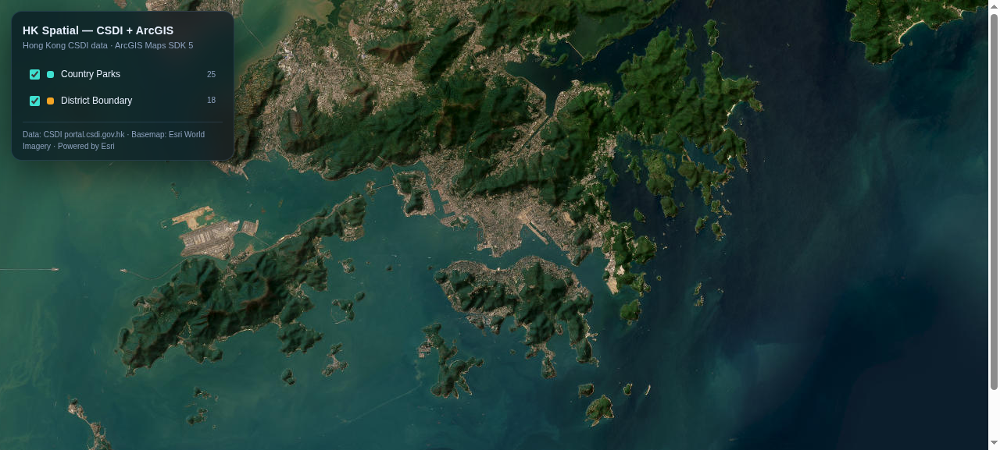

# hk-spatial-mcp

[](LICENSE)
[](pyproject.toml)
[](https://modelcontextprotocol.io)



[](https://github.com/Cyruschu430/hk-spatial-mcp/actions/workflows/selftest.yml)

An **MCP (Model Context Protocol) server for Hong Kong CSDI spatial data**. It gives any MCP-capable AI
client the ability to search the entire Common Spatial Data Infrastructure catalogue, retrieve datasets
as GeoJSON, and render them as an interactive web map — without writing HTTP code or knowing the
portal's data-export conventions.

> **Unofficial, community project.** CSDI is operated by the Spatial Data Office, Development Bureau,
> HKSAR Government. The Office has stated that it plans to develop its own CSDI MCP server in 2027.
> This repository is an independent implementation and claims no affiliation with the Government, the
> Spatial Data Office, or Esri.

**Contents**

- [Capabilities](#capabilities)
- [Requirements](#requirements)
- [Installation](#installation)
- [Prompt cookbook](#prompt-cookbook)
- [Tool reference](#tool-reference)
- [Configuration](#configuration)
- [Data source and coverage](#data-source-and-coverage)
- [Using it without the SDK](#using-it-without-the-sdk-or-inside-your-own-information-system)
- [Keyless Esri services](#keyless-esri-services)
- [Performance](#performance)
- [SDK and design system](#sdk-and-design-system)
- [Design notes](#design-notes)
- [FAQ](#faq)
- [Troubleshooting](#troubleshooting)
- [Verification](#verification)
- [Licensing and attribution](#licensing-and-attribution)

---

## Capabilities

| Capability | Detail |
|---|---|
| **Catalogue search** | All 1,154 CSDI datasets, indexed locally and relevance-ranked. English, 繁體中文 and 简体中文 queries supported. |
| **Data retrieval** | Any dataset as GeoJSON in EPSG:4326, returned as a summary (feature count, geometry types, attribute fields, bounding box) rather than a raw feature dump. |
| **Map rendering** | One or many datasets rendered as an interactive **2D map** or **3D scene** (ArcGIS Maps SDK for JavaScript, keyless public basemap; 3D adds Terrain3D relief), served on `localhost`. |
| **Feature inspection** | Click any feature to open an attribute card — every field from the dataset, bilingual column names where CSDI provides them, URLs rendered as links. |
| **Answers, not just maps** | `summarise_hk_data` answers a question in text — counts, sums or averages grouped by any field — and renders a bar chart page. |
| **Geocoding and geometry** | Address ↔ coordinate (both directions), project / buffer / simplify on any GeoJSON geometry, ground elevation, via Esri's public services. No key required. |
| **Basemaps** | 11 keyless Esri basemap styles (imagery, topographic, streets, light/dark gray, terrain, hillshade, ocean, physical, natgeo, shaded relief) plus an optional labels overlay. |
| **Static map export** | Render a basemap PNG (no key) into the workspace for reports and decks. |
| **ArcGIS Online (optional)** | Publish a dataset as a hosted feature layer, or call any ArcGIS REST endpoint (item search, feature queries, geoprocessing jobs) with your own token. |

The data layer is the primary value: CSDI is the source of truth. The map renderer is interchangeable,
and the ArcGIS Online tools are optional extensions that require your own credentials.

---

## Requirements

- Python 3.10 or newer, or [`uv`](https://docs.astral.sh/uv/) (recommended — `uvx` runs the server without a manual install)
- An MCP-capable client (Claude Desktop, Cursor, WorkBuddy / CodeBuddy, Codex, Hermes, or any stdio MCP client)
- Network access to `portal.csdi.gov.hk`
- *Optional:* an ArcGIS Online user or OAuth token, needed only for the publishing and content tools

---

## Installation

Add the server to your MCP client configuration:

```json
{
  "mcpServers": {
    "hk-spatial": {
      "command": "uvx",
      "args": ["--from", "git+https://github.com/Cyruschu430/hk-spatial-mcp", "hk-spatial-mcp"],
      "env": {
        "ARCGIS_TOKEN": "",
        "HK_MCP_PORT": "8777"
      }
    }
  }
}
```

Configuration file locations vary by client:

| Client | Configuration file |
|---|---|
| Claude Desktop (macOS) | `~/Library/Application Support/Claude/claude_desktop_config.json` |
| Cursor | `<project>/.cursor/mcp.json` |
| WorkBuddy / CodeBuddy | `~/.workbuddy/mcp.json` or `<project>/.workbuddy/mcp.json` |
| Codex | `~/.codex/config.toml` |

Any client that speaks MCP over stdio will work; the JSON shape above is the common form. Once the
client reports the server as connected, the tools are available in the conversation.

**Windows note.** `uvx --from git+…` needs `git` on `PATH`. Set `HK_MCP_DIR` to an absolute path
(for example `C:\\Users\\you\\hk-spatial`) — the default `./hk-spatial` is relative to whatever working
directory the client happens to launch with. Maps are served on `http://localhost:<HK_MCP_PORT>/`, so
open that URL in your own browser.

**Manual installation (without `uvx`)**

```bash
git clone https://github.com/Cyruschu430/hk-spatial-mcp
cd hk-spatial-mcp
pip install "mcp>=1.2"
python3 hk_spatial_mcp.py          # stdio MCP server
```

---

## Prompt cookbook

Ready-to-use instructions for an AI client. The English and Chinese versions are equivalent — use
whichever suits your users; the underlying tool calls are identical.

### 1. Connectivity check

```
Search the CSDI catalogue for "country park" using hk-spatial and list the first five datasets.
```
```
用 hk-spatial 搜尋 CSDI 目錄中的「郊野公園」，列出前五個數據集。
```

### 2. Data to map (the core workflow)

```
Using hk-spatial, find the Hong Kong country parks dataset, load it, and build an interactive web map
titled "HK Country Parks". Then report the preview URL.
```
```
用 hk-spatial 找出香港郊野公園數據集，載入後建立一個標題為「HK Country Parks」的互動地圖，
並回報預覽網址。
```

### 3. Chinese-language query, single layer

```
Using hk-spatial, find the location data for public toilets in Hong Kong and produce a map.
```
```
用 hk-spatial 找出全港公廁的位置數據，並產生地圖。
```

### 4. Multiple layers in one map

```
Using hk-spatial, retrieve three datasets — electric vehicle chargers, public hospitals and the
pedestrian network — and place them all on a single map with a distinct colour per layer and the
dataset name shown in the legend.
```
```
用 hk-spatial 同時取得三組數據：電動車充電站、公立醫院及行人路網絡，全部放在同一張地圖上，
每層使用不同顏色，並在地圖圖例中標示數據集名稱。
```

### 5. Extending an existing map

```
Using hk-spatial, add the bus routes dataset to the map you just built and confirm when it is added.
```
```
用 hk-spatial 在剛才建立的地圖上再加入「巴士路線」數據集，完成後通知我。
```

### 6. Catalogue reconnaissance before committing

```
Using hk-spatial, list every dataset related to slope safety and describe each one in a single sentence.
```
```
用 hk-spatial 列出所有與斜坡安全相關的數據集，並為每個數據集提供一句說明。
```

### 7. Geocode an address onto the map

```
Using hk-spatial, geocode "Hong Kong Convention and Exhibition Centre" and add it to a map as a
single labelled point.
```
```
用 hk-spatial 將「香港會議展覽中心」地理編碼，並以單一標註點加入地圖。
```

### 8. Coverage ring (buffer) around a facility

```
Using hk-spatial, load the electric vehicle chargers dataset, then produce a 500-metre buffer around
the first charger with geometry_op and add it to the map so the coverage ring is visible.
```
```
用 hk-spatial 載入電動車充電站數據，再用 geometry_op 為第一個充電站建立 500 米緩衝區，
並加入地圖以顯示其覆蓋範圍。
```

### 9. Ask a question, get a table and a chart

```
Using hk-spatial, find the EV charger dataset and tell me how many public chargers there are in each
district, with a bar chart.
```
```
用 hk-spatial 搵電動車充電站數據，話我知每區有幾多個公眾充電站，並出一張棒形圖。
```

### 10. Same data as a 3D scene

```
Using hk-spatial, take the country parks and slopes datasets and render them as a 3D scene with terrain
relief, camera tilted about 60 degrees, then give me the scene URL.
```
```
用 hk-spatial 將郊野公園及斜坡數據渲染成 3D 場景，開啟地形起伏、鏡頭傾斜約 60 度，
並提供場景網址。
```

### 11. Publish to ArcGIS Online *(requires `ARCGIS_TOKEN`)*

```
Using hk-spatial, publish the country parks dataset to my ArcGIS Online organisation as a hosted
feature layer titled "HK Country Parks" and return the item link.
```
```
用 hk-spatial 將郊野公園數據集發佈到我的 ArcGIS Online 組織，命名為「HK Country Parks」，
並回報項目連結。
```

### 12. Query existing ArcGIS Online content *(requires `ARCGIS_TOKEN`)*

```
Using hk-spatial's arcgis_request tool, list the five most recent feature layers in my ArcGIS Online
account together with their names and item IDs.
```
```
用 hk-spatial 的 arcgis_request 工具，列出我 ArcGIS Online 帳戶中最近五個圖層服務的名稱與項目 ID。
```

### 13. Enforce the intended workflow

Load `SKILL.md` as the agent's skill or system prompt. It constrains the agent to the
search → load → build_map sequence, prohibits fabricating data, prohibits pasting feature records into
the conversation, and requires the "Powered by Esri" attribution to be preserved.

If the agent starts writing its own HTTP code, instruct it explicitly:

```
Do not write custom fetch code. Use the hk-spatial tools — they already handle CSDI's catalogue
search, GeoJSON export, coordinate system and non-spatial datasets.
```
```
請勿自行編寫抓取程式碼，改用 hk-spatial 工具；它已處理 CSDI 的目錄搜尋、GeoJSON 匯出、
坐標系統及非空間數據集等細節。
```

---

## Tool reference

### `search_hk_data(keyword: str = "", limit: int = 10, offset: int = 0)`

Searches all 1,154 CSDI datasets using the local index. Returns `dataset_id`, English and Chinese
titles, publishing organisation, last update date, relevance score and an `exportable` flag.

- Omitting `keyword` enumerates the catalogue; paginate with `offset`. `limit` is capped at 30.
- English and Chinese queries are both supported; Hong Kong terminology is expanded automatically
  (廁所 → 洗手間, 行人路 → pedestrian, 電動車 → electric vehicle charging, 斜坡安全 → slope).
- When nothing matches locally, the tool falls back to the CSDI catalogue service for broader recall.

### `load_hk_data(dataset_id: str, name: str = "")`

Downloads a dataset as GeoJSON (EPSG:4326) into the workspace and returns a summary: feature count,
geometry types, attribute field names, bounding box and file path. Feature records are never returned
to the model.

### `summarise_hk_data(dataset_id, group_by="", value_field="", agg="count", top=20)`

Answers a question about a dataset in **text**, without putting features into the chat.

- No `group_by` → an overview: feature count, geometry types, the fields worth grouping by (with their
  cardinality) and the numeric fields.
- `group_by="NAME_OF_DISTRICT_COUNCIL_DISTRICT_EN"` → features per group.
- `agg="sum"` (or `"avg"`) plus `value_field="MEDIUM_IEC62196_no"` → totals or averages per group.

Returns an aligned text table, the same rows as data, and a `chart_url` for a rendered bar chart page.
Example — EV charging sockets per district in Hong Kong:

```text
group                  sum of MEDIUM_IEC62196_no
---------------------------------------------
Kwun Tong                            1,438
Kowloon City                         1,229
Sha Tin                                874
...
```

### `build_map(dataset_ids, title="Hong Kong Spatial Data", basemap="imagery", labels=False)`

Builds an interactive map from the loaded datasets and serves it on `http://localhost:<HK_MCP_PORT>/`.
Returns the URL, layer list, total feature count and warnings for oversized layers. Layers above 3,000
features are streamed from the served file rather than inlined into the page.

`basemap` accepts any keyless style: `imagery`, `topographic`, `streets`, `light-gray`, `dark-gray`,
`terrain`, `hillshade`, `ocean`, `physical`, `natgeo`, `shaded-relief`. `labels=True` adds Esri's
boundaries-and-places reference overlay on top.

**Clicking a feature** opens an attribute card in the bottom-left corner of the page: every attribute field
of that feature, `NAME_TC` / `LOCATION_TC` shown next to the English columns, and any URL rendered as a
link. The field labels come from the dataset itself, so nothing is hard-coded per dataset. Multi-layer maps
work the same way — whichever layer the click hits wins.

### `build_scene(dataset_ids, title="Hong Kong Spatial Data", basemap="imagery", labels=False, tilt=60)`

Same datasets as `build_map`, rendered in a **3D scene** served at `scene.html`: Terrain3D ground,
tilted camera (`tilt` degrees), lines and polygons draped on the terrain. Use it when relief, height or
coastal context matters — slopes, trails, towers, district skyline. Keyless, same warnings as `build_map`.

Both pages are plain static HTML with the same inline data pipeline, so you can keep the 2D map for
analysis and the 3D scene for the walkthrough of the same workspace.

### `geocode_address(single_line="", max_results=5, lon=None, lat=None)`

Geocodes an address or place name and returns candidates with longitude, latitude and a match score
(EPSG:4326). Pass `lon` and `lat` instead to **reverse geocode** a coordinate into a street address — in
Hong Kong it returns Chinese addresses. No key required; the endpoint is rate-limited, so use an ArcGIS
Location Platform key for production volumes.

### `elevation_at(lon: float, lat: float)`

Ground elevation in metres from Esri's public Terrain3D service. No key required.

### `export_static_map(bbox=None, center=None, zoom=14, basemap="streets", size="900,600")`

Renders a basemap PNG into `<workspace>/exports/` and returns the file path and a served URL. Give either
`bbox` (`minx,miny,maxx,maxy` in EPSG:4326) or `center` + `zoom`. No key required.

The image contains the **basemap only** — CSDI features are not drawn on it. For data-on-basemap statics,
render the interactive map and screenshot it, or use an ArcGIS Online print service (needs a token).

### `geometry_op(operation, geojson, in_sr=4326, out_sr=None, distance=500, unit="meters", max_deviation=None)`

Runs one geometry operation through Esri's public Geometry service and returns GeoJSON. No key required.

| Operation | Use |
|---|---|
| `project` | Reproject a geometry, e.g. `in_sr=2326, out_sr=4326` for CSDI layers published in HK1980 Grid |
| `buffer` | Coverage rings — `distance` in `unit` (`meters`, `kilometers`, `feet`, `miles`, `nauticalmiles`) |
| `simplify` | Reduce vertex count on large polygons before rendering (`max_deviation` in input units) |

Accepts and returns GeoJSON `Point`, `MultiPoint`, `LineString`, `MultiLineString`, `Polygon` and
`MultiPolygon`.

### `arcgis_request(path: str, params: dict | None = None, method: str = "GET")`

Calls any ArcGIS REST endpoint with the configured token. The token is never echoed back in a response.

```python
arcgis_request("search", {"q": "owner:me", "num": 10})                      # find items
arcgis_request("content/items/<itemId>/data")                               # item JSON
arcgis_request("<featureServiceUrl>/0/query", {"where": "1=1", "returnCountOnly": "true"})
```

### `publish_layer(dataset_id: str, title: str = "", tags: str = "CSDI,Hong Kong")`

Uploads a dataset to ArcGIS Online as a hosted feature layer and returns the `itemId` and item URL.
Consumes organisation credits and storage capacity.

**Authentication.** `arcgis_request` and `publish_layer` require `ARCGIS_TOKEN` set to a user or OAuth
token. An ArcGIS API key is sufficient for basemaps and geocoding but cannot read or create
organisation content.

---

## Configuration

| Variable | Default | Purpose |
|---|---|---|
| `HK_MCP_DIR` | `./hk-spatial` | Workspace for the catalogue cache, downloaded GeoJSON and the generated map |
| `HK_MCP_PORT` | `8777` | Port for the map preview server |
| `HK_MCP_BIND` | `127.0.0.1` | Bind address for the map preview server; set `0.0.0.0` only behind a reverse proxy |
| `HK_MCP_PUBLIC_URL` | *(empty)* | Public base URL that `build_map` returns, e.g. `https://maps.example.hk/` |
| `HK_MCP_TRANSPORT` | `stdio` | `stdio`, `streamable-http` or `sse` |
| `HK_MCP_HOST` | `127.0.0.1` | Bind address for the HTTP transport |
| `HK_MCP_HTTP_PORT` | `8788` | Port for the HTTP transport (endpoint `/mcp`) |
| `ARCGIS_TOKEN` | *(empty)* | ArcGIS Online user/OAuth token; required only for the content and publishing tools |
| `ARCGIS_URL` | `https://www.arcgis.com` | Portal base URL, for ArcGIS Enterprise deployments |

---

## Data source and coverage

- **Source:** CSDI portal (`portal.csdi.gov.hk`) — CSW 2.0.2 catalogue service and the `file-api`
  GeoJSON export endpoint.
- **Coverage verified 2026-10-22:** 1,154 datasets from 70+ government departments and organisations.
- **Caching:** the full catalogue is retrieved in a single request (~2 s, ~2.8 MB) and cached for seven
  days as `catalog.json` in the workspace; searches then run offline.
- **Non-spatial datasets:** 13 of the 1,154 have no GeoJSON export and are flagged `exportable: false`;
  `load_hk_data` returns an explanatory error together with the metadata page link.
- **Licensing:** each dataset carries its own terms. CSDI data is published by the HKSAR Government —
  review the individual dataset's licence before redistribution or commercial use.

---

## Using it without the SDK, or inside your own information system

**Nothing to install for the rendering layer.** The map and scene pages load ArcGIS Maps SDK 5 from
`js.arcgis.com` as ES modules. There is no npm install, no bundler, no build step, and no ArcGIS account:
the only requirement is that the viewer's browser can reach `js.arcgis.com` and
`server.arcgisonline.com`. An agent that has never heard of the SDK still produces a working map,
because the server writes the page and reports a URL.

**The tools are plain Python.** Every tool is an ordinary function returning JSON — the MCP wrapper is
separate. If you are building an information system (a portal, an internal dashboard, a report
generator), import them directly and skip MCP altogether:

```python
from hk_spatial_mcp import search_hk_data, load_hk_data, summarise_hk_data, build_map

hit = json.loads(search_hk_data("電動車充電", 1))["hits"][0]
load_hk_data(hit["dataset_id"], hit["title"])

stats = json.loads(summarise_hk_data(hit["dataset_id"],
                                     "NAME_OF_DISTRICT_COUNCIL_DISTRICT_EN", "", "count"))
print(stats["table"])          # a text answer for the UI
print(stats["chart_url"])      # an SVG bar chart page, same origin as the map

map_url = json.loads(build_map([hit["dataset_id"]], "EV chargers"))["url"]
```

That is the whole integration: text answers, a chart page, a map page — all from the same process, with
no cloud account and no billing.

## Keyless Esri services

Everything in this table answered without a key or token when verified on 2026-10-22, and is wired into a
tool where one exists:

| Service | Use | Tool |
|---|---|---|
| `server.arcgisonline.com/.../<Basemap>/MapServer` | 11 basemap styles + boundaries/labels overlay | `build_map(basemap=…)` |
| `<Basemap>/MapServer/export` | server-side basemap PNG | `export_static_map()` |
| `utility.arcgisonline.com/.../Geometry/GeometryServer` | `project`, `buffer`, `simplify`, `convexHull`, `findTransformations` | `geometry_op()` |
| `geocode.arcgis.com/.../World/GeocodeServer` | `findAddressCandidates`, `reverseGeocode` | `geocode_address()` |
| `elevation3d.arcgis.com/.../Terrain3D/ImageServer` | `identify` → ground elevation | `elevation_at()` |
| Public Living Atlas feature services | read-only reference layers (e.g. `World_Countries`) | `arcgis_request()` / layer URL |

**Needs `ARCGIS_TOKEN`, and usually credits:** AGOL standard analysis (`analysis.arcgis.com`), routing
(`route-api.arcgis.com`), GeoEnrichment, print services, and any content in your own organisation.

**Tested and deliberately not wrapped:** the Geometry service's `lengths`, `areasAndLengths`, `distance`,
`densify`, `labelPoints` and `autoComplete` operations reject the standard parameter names this client
sends (`empty geometry` / `must be specified` errors). They are not exposed rather than exposed broken —
compute lengths and distances locally, which is exact enough at city scale anyway.

## SDK and design system

The rendering layer is deliberately thin and explicit, so it doubles as a reference implementation:

| Piece | What is used | Where |
|---|---|---|
| Maps SDK | ArcGIS Maps SDK for JavaScript **5.0**, ESM modules from `js.arcgis.com/5.0` | the template in `hk_spatial_mcp.py` |
| 2D / 3D views | `MapView` and `SceneView` over the same `Map` object | `build_map` vs `build_scene` |
| Terrain | `ElevationLayer` on `map.ground` (Terrain3D, keyless) | 3D scene only |
| Data layers | `GeoJSONLayer` with a geometry-aware renderer, streamed above 3,000 features | both |
| Basemaps | `TileLayer` against public `arcgisonline.com` services | both |
| UI | hand-written dark glass CSS — no component library, no build step | both pages |

**Calcite (Esri's design system) is not bundled on purpose.** The template's CSS exists so the page works
with zero dependencies and stays readable when you customise it. If you want Calcite components for a
production app, the CDN is available and versioned:

```html
<link rel="stylesheet" href="https://js.arcgis.com/calcite-components/3.3.0/calcite.css" />
<script type="module" src="https://js.arcgis.com/calcite-components/3.3.0/calcite.esm.js"></script>
<calcite-block heading="Layers" open> … </calcite-block>
```

Those two URLs were confirmed reachable (200, `text/css` and JS) but are not exercised by this
repository's tests — swap the panel markup for `calcite-shell` / `calcite-block` / `calcite-list` and
verify visually before shipping.

## Performance

Measured on a 2 vCPU / 3.5 GB VPS with a warm catalogue cache:

| Step | Time |
|---|---|
| `search_hk_data` (local index) | 10–20 ms |
| `load_hk_data`, first download (small dataset) | 0.3 s |
| `load_hk_data`, first download (87,946 features / 30 MB) | 14 s |
| `load_hk_data`, cache hit (same layer) | 0.3 s — the file is reused; `refresh=True` re-downloads |
| `build_map` / `build_scene` (any layer count) | under 25 ms — it writes HTML, the browser does the rest |
| 2D page until `view.when()` resolves (headless Chrome, 3 layers, no GPU) | 2.8 s, 250 requests |

The 3D scene is heavier on the client: same data plus terrain tiles and WebGL. On a GPU-less headless
browser it stays saturated well past 30 s, which says nothing useful about a real machine — open
`scene.html` locally and read `window.__readyMs` in the console for your own number.

The model-facing cost is small by design: a full search → load → build_map flow returns roughly
2,600 characters of JSON, so the agent does not need long reasoning to produce a map.

## Design notes

- **No SDK popup.** On Maps SDK 5.0 a programmatically created `MapView` does not inject the popup UI —
  the popup is a beta web component (`<arcgis-popup>`) and `popupEnabled` on its own opens nothing. Rather
  than pull in a beta component, the template ships one `view.on("click")` handler and one styled card.
  Predictable across SDK releases, and it matches the rest of the UI.
- **Every layer is served by URL.** `GeoJSONLayer` with an inline `data` property (and with `blob`)
  fails to load on 5.0 — `TypeError: Cannot read properties of null (reading 'type')`. All layers are
  written to `data/<dataset>.geojson` and referenced by URL, so there is one code path and the HTML stays
  small.

- **Why a local index.** The catalogue service's `AnyText` query is high-recall but low-precision
  (a Chinese query such as 廁所 returns 185 hits with irrelevant ranking). Indexing the full catalogue
  locally allows field-weighted ranking across English, Traditional and Simplified Chinese metadata,
  and removes a network round-trip from every search.
- **Large datasets.** `file-api` returns complete datasets — for example Registered Man-made Slopes is
  61,527 features (153 MB) and Building is 87,946 features (30 MB). Layers above 3,000 features are
  streamed from the served file instead of embedded in the HTML, and layers above 60 MB produce an
  explicit performance warning. Data is never silently sampled or truncated.
- **Coordinate system.** All output is EPSG:4326. No reprojection is performed, and a Hong Kong
  bounding-box assertion guards the pipeline against projection errors.
- **Basemap.** Keyless Esri World Imagery tiles with the SDK's own attribution. Attribution is a
  licensing requirement of the basemap — keep "Powered by Esri" visible if you adapt the template.

---

## FAQ

### Do I need an ArcGIS account?

No. `search_hk_data`, `load_hk_data` and `build_map` need no account, no key and no subscription —
the basemap uses Esri's keyless public tiles and CSDI itself is open data. Only `publish_layer` and
`arcgis_request` require `ARCGIS_TOKEN`; without it they return a clear error and the other three tools
continue to work normally. If you never need ArcGIS Online, ignore those two tools entirely: the
GeoJSON is already on disk, so you can ship it to your own server, a static site, or any other viewer.

### What about geoprocessing / spatial analysis?

There is no built-in analysis engine, and that is deliberate — the server's job is to get authoritative
data out of CSDI intact. Two supported routes:

1. **ArcGIS public geometry operations (no key, no credits).** `geometry_op` covers projection, buffering
   and simplification — enough for coverage rings, CSDI layers published in HK1980 Grid, and rendering
   preparation. `geocode_address` covers address → point. Both are exercised by the self-test.
2. **ArcGIS Online geoprocessing.** Locate a GP service task and drive it through `arcgis_request`:
   `submitJob` with the parameters, then poll `jobs/<jobId>`. This requires `ARCGIS_TOKEN`, and the
   service consumes organisation credits. The request passthrough itself is implemented and its token
   handling is tested; a live geoprocessing run has **not** been exercised in this repository's test
   suite (no test organisation credentials are bundled), so validate against your own service before
   relying on it.
3. **Local analysis.** Every dataset is on disk as GeoJSON in EPSG:4326, so an agent can process it with
   whatever Python stack is installed (`shapely`, `pyproj`, `geopandas`, `duckdb spatial`) and hand the
   result back through `build_map`. This keeps the analysis explainable and free of credit costs.

### Are any web development dependencies required?

None. `build_map` writes a single static HTML file and serves it with Python's standard-library HTTP
server. The map library (ArcGIS Maps SDK for JavaScript) is loaded as ES modules from
`js.arcgis.com/5.0` — no npm, no Node.js, no bundler, no build step, no transpiler. The generated page
is plain HTML/CSS/JS you can open, edit or re-host anywhere.

Requirement to be aware of: the browser must be able to reach `js.arcgis.com` and
`server.arcgisonline.com`. In an air-gapped or restricted intranet deployment the map will render blank —
self-host the SDK assets and substitute a locally reachable tile source in that case.

On the server side the only dependency is the `mcp` package (`uvx` installs it automatically); everything
else is the Python standard library.

### Does it work alongside other agent skills and tools?

Yes. It is a standard MCP server over stdio or HTTP, so it composes in the same client with any other
MCP server — file system, git, web search, databases, or other geospatial servers. Nothing here assumes it
is the only tool available.

Two mechanisms improve reliability when several tools are present:

- **`SKILL.md`** — load it as the agent's skill or system prompt to pin the search → load → build_map
  sequence and prohibit ad-hoc HTTP code.
- **Self-describing tool metadata** — each tool documents its arguments and return shape, so most clients
  route correctly without extra prompting.

The wider GIS MCP ecosystem (including Esri's ArcGIS Location Services MCP and various ArcGIS Pro /
ArcPy bridges) is complementary rather than duplicative: those expose geoprocessing and location services,
whereas this server's focus is the CSDI data layer.

### Can it run as a remote MCP server?

Yes. stdio is only the default. Set the transport and it serves MCP over HTTP:

```bash
HK_MCP_TRANSPORT=streamable-http HK_MCP_HOST=0.0.0.0 HK_MCP_HTTP_PORT=8788 python3 hk_spatial_mcp.py
# endpoint: POST http://<host>:8788/mcp   (text/event-stream; `sse` is also supported)
```

Verified in this repository: `initialize` and `tools/list` succeed over Streamable HTTP. Clients that
support HTTP MCP servers connect to the URL and headers instead of spawning a process.

Two things must be configured for the map to be usable by a remote caller:

```bash
HK_MCP_BIND=0.0.0.0                       # let the map preview server accept non-loopback traffic
HK_MCP_PUBLIC_URL=https://maps.example.hk/  # the URL build_map returns to the caller
```

**Deployment caveats — read before exposing it:**

- **This repository does not host, deploy or operate any server.** Running it remotely is entirely the
  operator's responsibility.
- **There is no built-in authentication.** Do not expose the port to the internet directly. Terminate TLS
  and enforce a bearer token or OAuth at a reverse proxy in front of it (MCP's OAuth flow requires an
  authorization server, which is out of scope here).
- **A shared `ARCGIS_TOKEN` makes every caller act as that account.** For any multi-user deployment, issue
  per-user tokens, or expose read-only tools only, or omit the publishing tools from the deployed build.
- **State is per process.** The workspace directory and the single map preview are shared by all callers,
  so concurrent users overwrite each other's map. For real multi-tenant use, run one process (with its own
  `HK_MCP_DIR`) per user or per session.

## Troubleshooting

| Symptom | Cause and resolution |
|---|---|
| Client reports the server as disconnected | The process exited during start-up. Run `python3 hk_spatial_mcp.py` directly to see the traceback; the usual cause is a missing `mcp` package or Python older than 3.10. |
| `ARCGIS_TOKEN not set` | Expected for the two ArcGIS Online tools. Set a user or OAuth token in the client's `env` block. |
| `HTTP 404` on `load_hk_data` | The dataset has no GeoJSON export (13 of 1,154). Search again and use a result with `exportable: true`. |
| The map does not refresh | The preview page must be reloaded after each `build_map` call. |
| The map is slow or the browser stalls | The layer is very large. Use the `warn` output from `build_map` as a guide and prefer smaller or district-level datasets. |
| Port 8777 is already in use | Set `HK_MCP_PORT` to a free port in the client's `env` block. |

---

## Verification

```bash
python3 hk_spatial_mcp.py --selftest
```

The self-test harvests the catalogue, asserts it contains more than 1,100 datasets, runs English and
Chinese searches with expected top results, downloads a dataset, asserts Hong Kong coordinates, builds
the map and confirms the page is served.

Two integration tests exercise the MCP protocol over stdio:

```bash
python3 test_mcp_client.py       # against the local file
python3 test_install_path.py     # against the published git URL — i.e. what users actually install
```

---

## Licensing and attribution

- Source code: MIT (see [LICENSE](LICENSE)).
- CSDI data: © HKSAR Government, subject to each dataset's licence.
- Basemap: Esri World Imagery, used under Esri's terms; "Powered by Esri" attribution retained.
